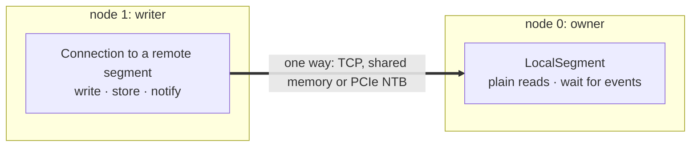

# pushseg

**Write far, read local.**

[](https://github.com/oguzhankynk/pushseg/actions/workflows/ci.yml)
[](https://github.com/oguzhankynk/pushseg/releases/latest)
[](LICENSE)

pushseg is a C++17 transport layer for sharing data between processes on
different targets (machines). Applications see a single model: they **read
their own segments through plain pointers** and **write into remote segments
through one-way connections**. Whether the bytes travel over TCP, POSIX shared
memory, a PCIe NTB link, or another API plugged in as a backend is chosen per node pair in a
config file, and the application code does not change.



The same ping-pong program (`examples/pingpong.cpp`: an 8-byte store and a
spin on local memory, then 1 MiB writes), with only the config changed:

| Backend | Round trip (median) | 1 MiB writes | Setup |
|---|---|---|---|
| `shm` | 0.16 µs | 26 GB/s | two processes, one machine |
| `ntb` | 0.16 µs | 2.7 GB/s | two VMs on a virtual NTB ([qemu-ntb](https://github.com/oguzhankynk/qemu-ntb), fast windows) |
| `tcp` | 34 µs | 6 GB/s | two processes, loopback |

One laptop (i3-12100F); orders of magnitude, not a benchmark. Over NTB
between two VMs the "link" is shared memory, so real NTB hardware adds its
PCIe latency.

## Getting it

```cmake
include(FetchContent)
FetchContent_Declare(pushseg
  GIT_REPOSITORY https://github.com/oguzhankynk/pushseg.git
  GIT_TAG v0.3.0)
FetchContent_MakeAvailable(pushseg)
target_link_libraries(myapp PRIVATE pushseg::pushseg)
```

Or install it (`cmake --install`) and use `find_package(pushseg)`.

## Concepts

| Concept | Meaning |
|---|---|
| **Segment** | Memory owned by one process. The owner reads it with plain pointers. |
| **Connection** | A **one-way** write channel into a remote segment. Two-way traffic uses two segments. |
| **SegKey** | `[app:8][inst:8][seg:16]`, unique on a node. `(node, SegKey)` is the global address. |
| **Event** | Delivered to the owner: `kConnect`, `kDisconnect`, `kNotify(imm)`. |

There are **no remote reads**, by design. Remote reads are expensive on every
transport (non-posted on PCIe, a round trip on TCP), so the rule is: write to
the remote side, read from local memory.

## Memory contract

These rules hold on every backend, and higher layers are built on them:

1. **`write()`** is bulk data: no atomicity, no ordering relative to other `write()` calls.
2. **`store<T>()`** (1/2/4/8 bytes, aligned to `sizeof(T)`) is **single-copy atomic**: a reader
   sees the old or the new value, never a mix.
3. **`store()`, `notify()` and `write_notify()` are ordering points**: everything sent before
   becomes visible no later than the point itself, and nothing sent after becomes visible before it.
4. Ordering holds **per connection**. Different writers are unordered.
5. Readers read flags with **`pushseg::load<T>()`** (acquire). Data guarded by the flag may then be
   read with plain loads.
6. There are no atomic updates larger than 8 bytes. Use data + flag, a seqlock, or double buffering.

Typical pattern:

```cpp
// writer                                   // owner
c.write(64, buf, n);                        while (pushseg::load<uint64_t>(seg.data()) != seq) {}
c.store<uint64_t>(0, seq);                  use(seg.at<char>(64));    // safe
// or: c.write_notify(64, buf, n, seq);     // or: seg.wait_event(ev, 1s);
```

The writer chooses the remote offset. Both sides should agree on the layout
through a shared struct and use `offsetof`, rather than magic numbers.

## Quick example

```cpp
#include <pushseg/pushseg.hpp>

pushseg::Config cfg = pushseg::Config::load("system.conf");

// node 0, owner
pushseg::Context ctx0(cfg, /*node=*/0, "algo");
pushseg::LocalSegment inbox = ctx0.create_segment(/*seg=*/1, 1 << 20);
inbox.publish();

// node 1, writer (another process or machine)
pushseg::Context ctx1(cfg, /*node=*/1, "algo");
pushseg::Connection c = ctx1.connect(/*node=*/0, "algo", /*inst=*/0, /*seg=*/1);
c.write_notify(0, data, len, /*imm=*/42);
```

For a runnable example, see `examples/pingpong.cpp` and `examples/pingpong.conf`.

## Config

```ini
[apps]
algo = 1

[node.0]
tcp   = 10.0.0.10            # backend name = backend-specific address (opaque to the core)
mybus = dev0                 # a backend you registered yourself (see below)

[node.1]
tcp = 10.0.0.11:41000        # tcp: optional per-node base port

[node.2]
tcp = 10.0.0.12

[links]
default = tcp                # node pairs without an explicit entry
0-1     = mybus              # 0 <-> 1 over your backend, everything with node 2 over TCP

[backend.tcp]
base_port = 40000            # port = base + app*32 + inst
```

## Built-in backends

| Name | Level | Scope | Notes |
|---|---|---|---|
| `tcp` | Stream | Any hosts | One TCP connection per `Connection`. Address: `host[:base_port]`. |
| `shm` | Mapped | Same host | POSIX shared memory: writers store straight into the owner's memory. Address unused. |
| `ntb` | Mapped | Two hosts on a PCIe NTB link | Stores go through the NTB memory window into the peer's RAM; DMA for bulk writes. Needs the `ntb_seg` kernel module. Address unused. |
| `loopmem` | Mapped | Same process | Reference for writing a mapped backend; used by the tests. |

### `shm` (POSIX shared memory)

```ini
[links]
default = shm                # all nodes run on the same machine

[backend.shm]
name_prefix  = /pushseg      # segments: <prefix>.s.<node>.<key>; event queues: <prefix>.e.<node>.<app>.<inst>
lock_dir     = /dev/shm      # identity lock files: <lock_dir>/<prefix>.shm.<node>.<app>.<inst>.lock
event_maxmsg = 8             # pending notifications per process
```

- The data path is a plain store into mapped memory: no copy, no system call.
- Connect, disconnect and interrupt notifications go to the owner's POSIX message
  queue; they are queued, so none is lost.
- A destroyed segment or a dead owner (checked by pid) turns the writer's next
  notification into `kDisconnected`. A writer that dies without releasing its
  mapping is not reported to the owner.
- A process restarted with the same `(node, app, inst)` removes the segments and the
  event queue a crashed predecessor left.

### `ntb` (PCIe non-transparent bridge)

```ini
[links]
0-1 = ntb                    # the two nodes on the NTB link

[backend.ntb]
device       = /dev/ntb_seg0 # this node's end of the link
dma_threshold = 65536        # writes of at least this size use the NTB's DMA engine
interrupt_timeout_ms = 5000  # how long a notify waits for room in the peer's mailbox
start_timeout_ms = 30000     # how long start-up waits for the link to come up once
processes    = 1             # pushseg processes per node on this link (1 to 16)
```

- Needs [`ntb_seg`](https://github.com/oguzhankynk/ntb-lab) on both hosts: a small
  kernel module on top of the Linux NTB API, so any NTB hardware with a Linux driver
  works. Load it with a segment size that holds all segments of the node
  (`insmod ntb_seg.ko seg_size=4194304`; at most the memory window size).
- Without hardware: two VMs with [qemu-ntb](https://github.com/oguzhankynk/qemu-ntb).
  ntb-lab's `tests/t-pushseg.sh` runs `pushseg_pingpong` between them.
- Writes are plain stores into the mapped window; notifications are queued in a
  mailbox in the owner's memory, then a doorbell rings, so none is lost.
- Up to `processes` processes per node share the link. Each takes a partition of
  the node's segment (and of the DMA staging buffer) through a lock file in
  `lock_dir` (default `/tmp`); a process beyond that fails with `kExists`. Set the
  same value on both nodes, and load `ntb_seg` with the same `seg_size` on both.
  More than one needs as many doorbells and an `ntb_seg` that gives every open
  file every event (ntb-lab v0.1.0 or later).
- On a window that is trapped MMIO rather than mapped memory (qemu-ntb without
  `fast-mw`, or `ntbd`), set `dma_threshold = 0`: `memcpy` into trapped MMIO does not
  work there, DMA does.
- A peer that restarts or unloads the module turns the writer's next notification
  into `kDisconnected`; a new `connect()` finds the new segments.

The backend is chosen **per node pair**. One segment can be written over a mapped
backend and over TCP at the same time (`MixedBackendTest` covers this with the
in-process reference backend).

## Plugging in your own API

`include/pushseg/backend.hpp` defines two integration levels. Pick the one that matches your API:

| Level | You implement | The core does | Example |
|---|---|---|---|
| **Stream** (`StreamBackend`) | connect, listen, `sendv`, deliver received bytes via `on_recv` | The whole segment protocol: framing, writes, atomic stores, notify, fences | `src/backends/tcp.cpp` |
| **Mapped** (`MappedBackend`) | alloc/export/import, `store_barrier`, `interrupt`, optional DMA | `write` = memcpy/DMA, `store` = wait DMA + barrier + store + barrier, `notify` = barrier + interrupt | `src/backends/shm.cpp`, `src/backends/loopmem.cpp` |

At both levels the **core** enforces the atomicity and ordering contract. A
backend only moves bytes. Register it before creating a `pushseg::Context`:

```cpp
#include <pushseg/backend.hpp>

class MyBusBackend final : public pushseg::backend::MappedBackend { /* ... */ };

pushseg::backend::register_mapped_backend("mybus", [] { return std::make_unique<MyBusBackend>(); });
// config: [links] 0-1 = mybus
```

To validate a backend, add its name to the `INSTANTIATE_TEST_SUITE_P` list in
`tests/unit/test_transfer.cpp`. The same contract tests (tearing, ordering,
flush, disconnects...) then run against it.

## Building and testing

```bash
cmake --preset debug && cmake --build --preset debug && ctest --preset debug
cmake --preset asan  && cmake --build --preset asan  && ctest --preset asan
cmake --preset tsan  && cmake --build --preset tsan  && ctest --preset tsan   # uses clang
```

The `tsan` preset uses clang because GCC 11's libtsan does not intercept
`pthread_cond_clockwait` and reports false "double lock" errors.

Coverage counts only real branches (`--exclude-throw-branches`): every call that
may throw adds a hidden exception edge that tests cannot target.

Requirements: Linux x86_64, a C++17 compiler (GCC 11+ / Clang 14+), CMake 3.25+, Ninja.
Tests fetch GoogleTest via `FetchContent`.

Other presets inherited from the project template: `release`, `coverage`, `tidy`
(clang-tidy), `cppcheck`. `scripts/run_checks.sh` runs every gate in CI order.
The pre-commit hook in `.githooks/` checks formatting; enable it with
`git config core.hooksPath .githooks`.

## Layout

```
include/pushseg/
  pushseg.hpp     Context, LocalSegment, Connection, load<T>  (application API)
  backend.hpp     StreamBackend / MappedBackend SPI + registry (backend author API)
  config.hpp      Config file
  types.hpp       NodeId, SegKey, PeerId, Event
  status.hpp      Status, Error
src/core/
  context.cpp         Context, segment lifecycle, event queue
  wire.hpp/.cpp       Wire format of the stream protocol (32-byte header)
  stream_conn.cpp     Writer side: connect (with retry), framing, flush
  stream_inbound.cpp  Owner side: applies frames to the segment
  mapped_conn.cpp     Mapped level: turns the contract into barriers, DMA, interrupts
src/backends/
  tcp.cpp         Built-in stream backend (TCP)
  shm.cpp         Built-in mapped backend (POSIX shared memory, same host)
  ntb.cpp         Built-in mapped backend (PCIe NTB through ntb_seg)
  posix_common.hpp  Identity lock and helpers for shm and ntb; TSan annotations for shm and tcp
  loopmem.cpp     Built-in mapped backend (in-process; reference and tests)
tests/unit/       Config, wire, API, and end-to-end contract tests
examples/         pingpong + sample config
```

## Known limits and next steps

- The TCP backend uses one reader thread per link. Fine for tens of links; an epoll loop can replace it behind the same SPI.
- No TCP heartbeat. Disconnects are detected through TCP keepalive and socket errors.
- Mapped-level DMA writes currently wait synchronously. An async `write` API could defer the wait to the next ordering point.
- No remote read-modify-write atomics (`fetch_add`, CAS). Use one slot per writer for multi-writer counters.
- No exclusive (single-writer) segment flag yet.

## Related projects

| Project | What it is |
|---|---|
| [gridlane](https://github.com/oguzhankynk/gridlane) | Layered data distribution for parallel programs, built on pushseg |
| [ntb-lab](https://github.com/oguzhankynk/ntb-lab) | `ntb_seg`, the kernel module under the `ntb` backend; tests pushseg between two VMs |
| [qemu-ntb](https://github.com/oguzhankynk/qemu-ntb) | A virtual PCIe NTB for QEMU, to run the `ntb` backend without hardware |

## License

MIT, see [`LICENSE`](LICENSE).
